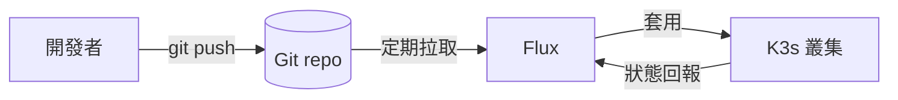
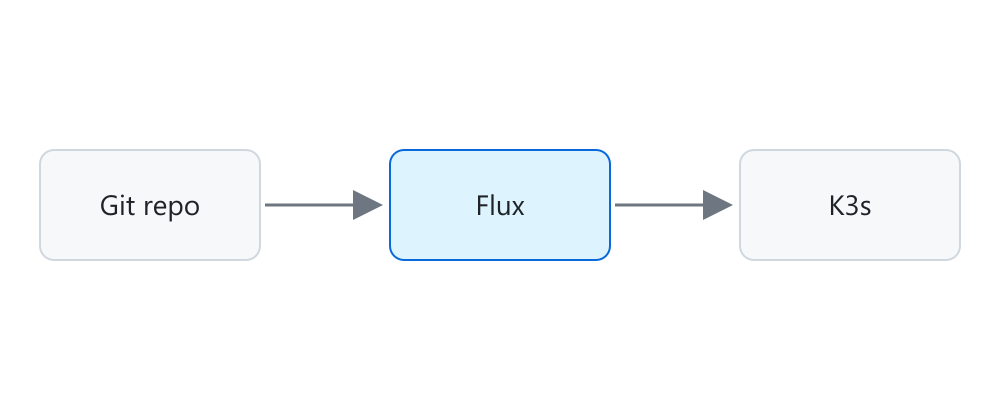
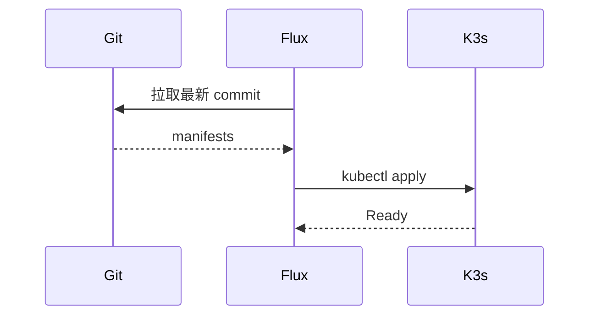

上一篇裝好了 K3s，這篇把叢集交給 Flux 管理。這也是一篇範例文章，示範**系列文章**、**Mermaid 圖表**和**文章內圖片**。

## GitOps 的流程

用 Mermaid 畫流程圖，只要在程式碼區塊標上 `mermaid`：



同樣的概念也可以用圖片表示（點圖片可以放大）：



## Bootstrap

```bash
flux bootstrap github \
  --owner=<你的帳號> \
  --repository=fleet \
  --path=clusters/home \
  --personal
```

> [!IMPORTANT]
> bootstrap 需要 GitHub token，請用環境變數 `GITHUB_TOKEN` 傳入，不要寫進指令或檔案。

## 確認同步狀態

```bash
flux get kustomizations
flux logs --follow
```

## 時序圖

Mermaid 也支援時序圖：


